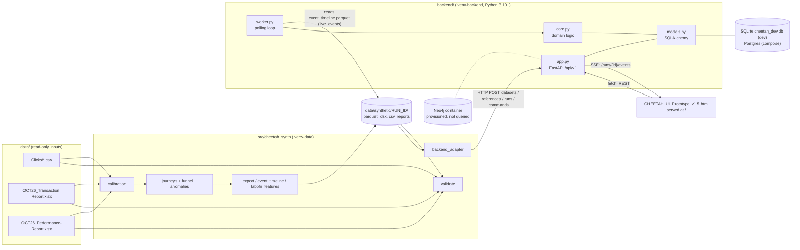
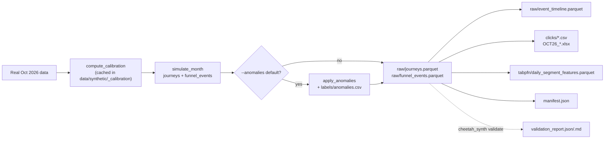
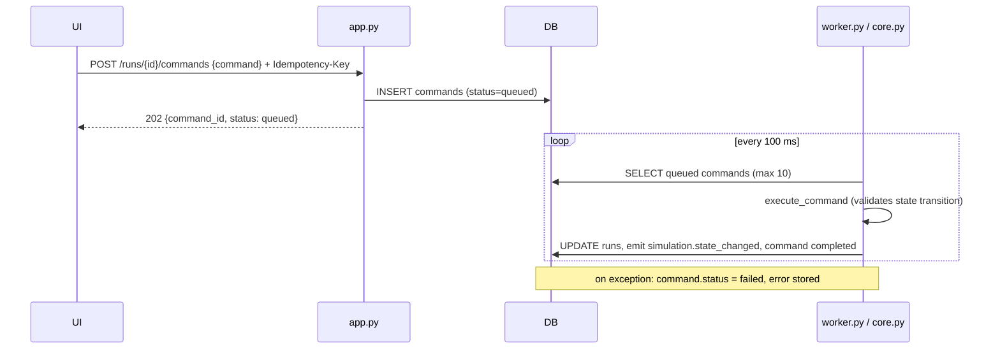
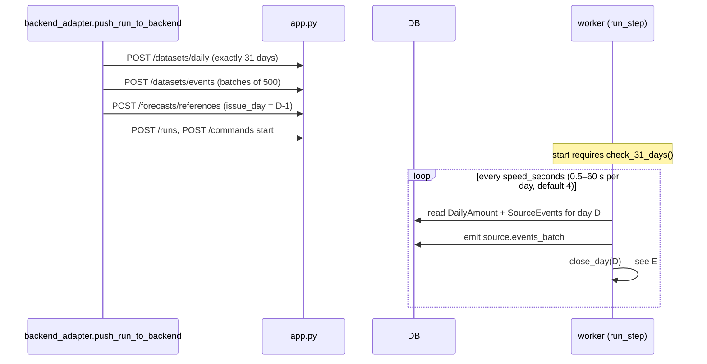
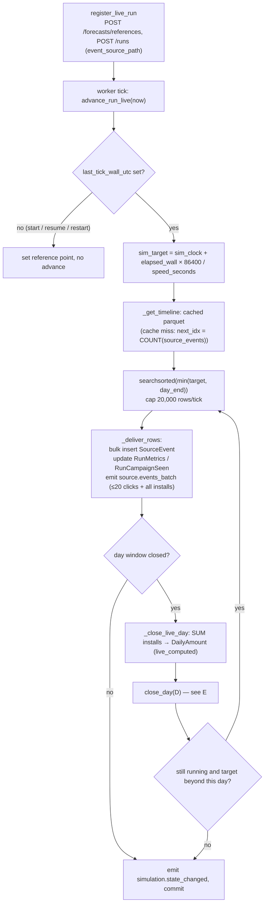
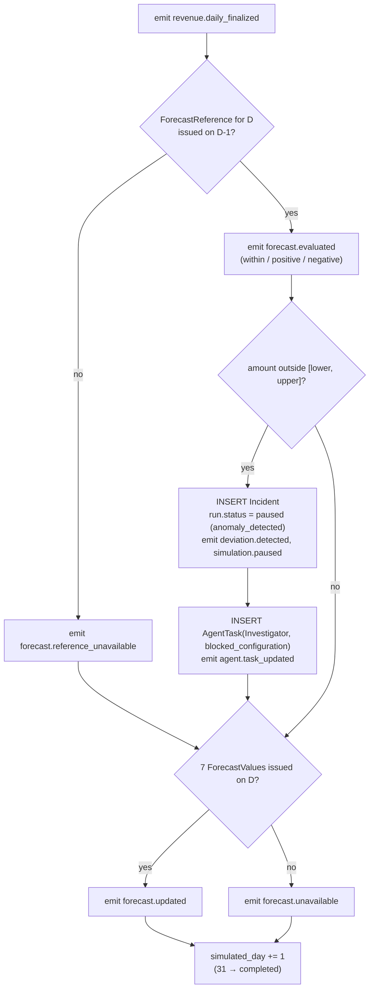
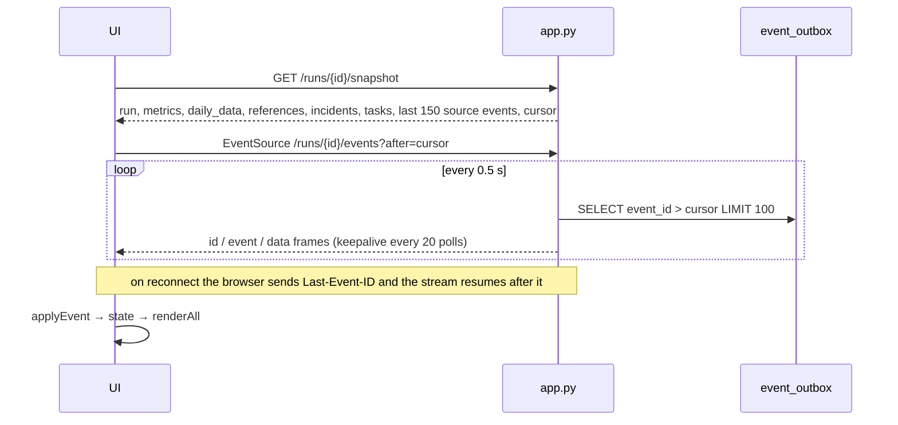
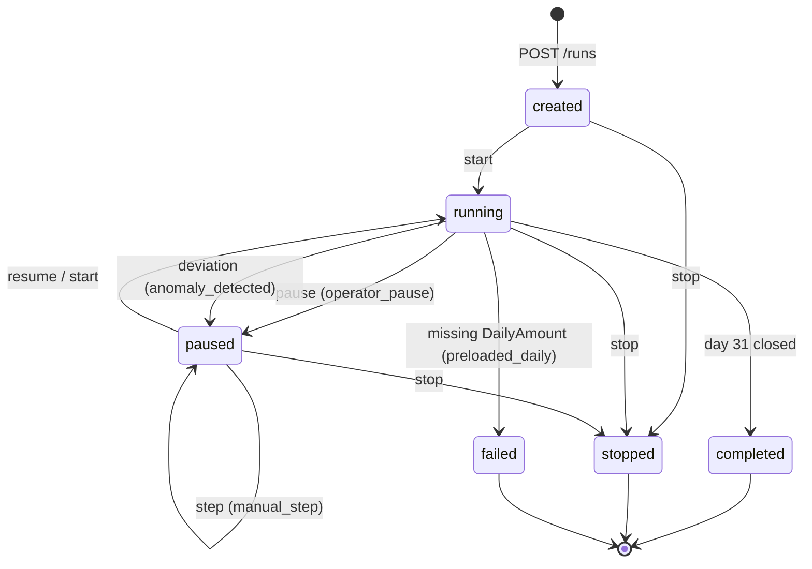

# CHEETAH Architecture

This document describes the components and dataflows of the code on `main`. Section 9 lists what
the target design adds that is not built yet. For the product brief see `DESCRIPTION.md`, for
requirements see `PRD/Master_PDR_v2.0.pdf`, and for working conventions see `CLAUDE.md`.

## 1. Overview

CHEETAH is meant to be a fully agentic performance-marketing monitor for an affiliate marketplace.
It forecasts revenue, detects deviations, investigates them, and reports with evidence.

What is built on `main` today is the **integration foundation** (Track A):

| Part | What it does |
|---|---|
| **Synthetic data generator** (`src/cheetah_synth/`) | Calibrates against the real October 2026 Freecash data and generates a click → funnel → conversion journey dataset, optionally with labeled anomalies |
| **Backend** (`backend/`) | FastAPI API plus a polling worker. It plays October 2026 back day by day (or event by event), compares each closed day to a locked forecast band, opens an incident on a breach, and publishes every state change through an outbox / SSE stream |
| **Frontend** (`frontend/CHEETAH_UI_Prototype_v1.5.html`) | A single-file, six-screen UI. It builds its state from a snapshot plus the SSE stream, and polls the live query endpoints for reports |

Forecasting (TabPFN), the Claude investigator / evidence reviewer, the Neo4j graph and replays are
**deliberately not connected**. In each case the system reports an explicit `unavailable` /
`blocked_configuration` / `409` state instead of producing a result (see §7).

## 2. Component diagram

## 3. Components

### Backend (`backend/`)

| File | Responsibility | Key entry points |
|---|---|---|
| `app.py` | HTTP surface. Validates and stores inputs, enqueues commands, serves the snapshot, the SSE stream and the live queries. It never advances a simulation itself | **Runs:** `GET/POST /runs`, `GET /runs/{id}/snapshot`, `POST /runs/{id}/commands`, `GET /runs/{id}/commands/{cid}`, `GET /runs/{id}/events` (SSE) · **Ingest:** `POST /datasets/daily`, `POST /datasets/events`, `POST /forecasts/references`, `POST /forecasts/outlooks` · **Live queries:** `GET /runs/{id}/source_events`, `GET /runs/{id}/performance_report`, `GET /runs/{id}/forecasts`, `GET /runs/{id}/incidents`, `GET /incidents/{id}/tasks` · **Stubs:** `POST /runs/{id}/replays` (409), `GET /runs/{id}/replays/comparison`, `GET /context/graph`, `GET /agents/status`, `GET /health` |
| `forecasting.py` | FC-01 forecast service. For `forecast_provider='tabpfn'` runs it is called after each day close (`core.forecast_after_close`, outside the close transaction). Triggered at each day rollover (emits `forecast.requested`), it forecasts D+1..D+7 (`FORECAST_HORIZON_DAYS`) with TabPFN-TS in cloud mode from the last 7 closed days (`FORECAST_CONTEXT_DAYS`) through D only, maps P10/P50/P90 to lower/point/upper, and locks D+1 as a `ForecastReference` (`source='tabpfn_ts'`). Warm-up (< `FORECAST_WARMUP_DAYS`, default 7), a missing token or package, and provider errors each emit `forecast.unavailable` with a reason. Nothing falls back. `forecast_backtest.py` replays the same call for MAE/WAPE/coverage/bias | `issue_forecast`, `predict_amount`, `store_outlook`, `config` |
| `core.py` | All domain logic: day close, deviation detection, both playback modes, command execution | `emit`, `close_day`, `run_step` (preloaded), `advance_run_live` / `_advance_to` / `_deliver_rows` / `_close_live_day` (live), `execute_command`, `_live_timelines` (LRU cache) |
| `env.py` | Loads the repo-root `.env` into `os.environ` when the API or worker starts. Variables already set win; `CHEETAH_SKIP_DOTENV=1` skips it | `load_env()` |
| `worker.py` | A single process that loops every 100 ms. It runs up to 10 queued `Command`s, then advances every `running` run. On startup it clears `last_tick_wall_utc` so that downtime doesn't turn into a catch-up burst | `main()` |
| `models.py` | Schema, engine, SQLite pragmas (WAL), `_recreate_if_schema_stale()` (SQLite only: deletes and rebuilds a dev DB whose schema is stale) | `initialize()`, `SessionLocal` |

**Tables** (`models.py`), grouped by role:

| Group | Tables | Notes |
|---|---|---|
| Inputs | `daily_amounts`, `source_events` | Scoped by dataset and immutable. Unique keys are `(dataset_id, day)` and `(dataset_id, kind, source_id)` |
| Forecasts | `forecast_references`, `forecast_values` | A reference is the **locked** band for day D, issued on D-1, and is what detection uses. A value is one day of a 7-day outlook |
| Run state | `runs`, `commands` | `runs` holds status, speed, `simulated_day`, `ingestion_mode`, the live clock (`sim_clock_utc`, `last_tick_wall_utc`). `commands` is the queue |
| Outbox | `event_outbox` | An append-only stream of events per run, which SSE reads from |
| Incidents | `incidents`, `agent_tasks`, `actions` | `actions` is schema only, nothing writes to it yet |
| Live KPIs | `run_metrics`, `run_campaigns_seen` | Updated on every live insert and backs the six KPI tiles |

### Synthetic generator (`src/cheetah_synth/`)

| Module | Responsibility |
|---|---|
| `real_data.py` | Loads the real clicks, transactions and performance report |
| `calibration.py` | Fits empirical distributions and bootstrap pools from the real data, plus a per-segment CVR with Beta-Binomial shrinkage |
| `journeys.py`, `funnel.py`, `identities.py` | `simulate_month`: segments, timestamps, conversions, funnel events, synthetic ID ranges |
| `anomalies.py` | Labeled injection of anomalies: traffic burst, CVR shock, payout shock, latency blowout (`build_default_catalog`, `apply_anomalies`) |
| `event_timeline.py` | `build_event_timeline`: one row per click/install, sorted by timestamp, plus vertical/category. This is the source for `live_events` |
| `export.py` | Writes click CSVs and the Transaction / Performance Report xlsx files in the real files' shapes |
| `tabpfn_features.py` | A table of daily segment features for a future forecaster |
| `validate.py` | Compares the synthetic distributions against the real ones and writes `validation_report.{json,md}` |
| `backend_adapter.py` | `push_run_to_backend` (preloaded) / `register_live_run` (live), and `build_naive_references` (a placeholder band: trailing mean) |
| `cli.py`, `config.py` | `calibrate`, `generate`, `validate`, `all`, `build-timeline`, `push-to-backend` |

### Frontend (`frontend/CHEETAH_UI_Prototype_v1.5.html`)

It has six screens: **Performance overview**, **Revenue forecast**, **Agentic Monitoring**
(incidents), **Marketplace**, **Data & reports**, and **Context Explorer**. A simulation toolbar
(create / start / pause / resume / speed / replays) and a pause banner sit across all of them.
`api()` wraps `fetch`, `connectStream()` opens the `EventSource`, and `applyEvent()` folds SSE
events into the client `state`.

### Runtime and infrastructure

| File | Role |
|---|---|
| `start_backend.sh` | Local development. Starts uvicorn (`--reload`) and `worker.py` together. Unless `SKIP_AUTO_PUSH=1` is set, it then auto-pushes the `full` synthetic run as a fresh `live_events` dataset (`synth-full-live-<timestamp>`) and starts it |
| `docker-compose.yml`, `Dockerfile` | Runs Postgres 16, Neo4j 5, `api` and `worker` (all from one image) |

## 4. Dataflows

### A. Synthetic generation (`cheetah_synth generate`)

### B. Command path (asynchronous by design)

The API only enqueues commands. The worker is the only component that changes run state.

The `Idempotency-Key` becomes the `command_id`. When a key is sent again, the API returns the
existing command instead of creating a second one.

### C. `preloaded_daily` playback

In this mode all rows exist before the run starts. The run only reveals them as
`simulated_day` advances. The snapshot and `get_run_metrics` filter by `MONTH_DAYS[:simulated_day]`.

### D. `live_events` playback

- Speed range is **3–60 s per simulated day** (default 5). The lower bound comes from a measured
  insert ceiling of about 129k events/s, against a peak of about 73.7k events/s at 3 s/day.
- Recovery after an eviction or restart doesn't need any saved cursor. Delivery is append-only in
  timeline order, so the number of `source_events` rows already stored is exactly how far the run got.
- The outbox carries only a small sample of each tick. Full fidelity lives in `source_events`.

### E. Day close and deviation detection (`core.close_day`)

Both playback modes use the same day close.

Detection today looks only at the aggregate `amount_total`. Where the band comes from depends on the run's
`forecast_provider`:
- **`external`** (default): references are imported. For the synthetic demo that's the naive trailing-mean
  placeholder from `build_naive_references` (`source="synthetic_naive_baseline"`).
- **`tabpfn`**: the worker issues them itself (`backend/forecasting.py`). `close_day` then skips the outlook
  block, `forecast_after_close` runs once the close is committed, and the live tick stops after that day
  (clock reset), so inference time never turns into simulated time. A `tabpfn` run evaluates against and
  displays only `source='tabpfn_ts'` references.

### F. Event delivery (outbox → SSE → UI)

### G. Live query path (Reports and Marketplace)

The **Data & reports** screen polls every 3 s while it is visible. **Marketplace** queries on demand.

- `GET /runs/{id}/source_events` filters by kind, placement, country, date range and text, uses
  keyset pagination on the row PK (`cursor`, `limit` ≤ 1000), and with `format=csv` streams the
  **full** filtered set in chunks of 5000.
- `GET /runs/{id}/performance_report` is a live `GROUP BY (game_placement_id, country)`. It derives
  `conversion_rate`, `ecpc` and `roas` with the same formulas as `cheetah_synth/export.py`. `ecpm`,
  `ctr` and the Freecash IDs stay `null`.

## 5. Run state machine

`step` requires `paused` (or `ready`, which `execute_command` accepts but nothing currently sets).
It advances exactly one day and then pauses again.

## 6. Outbox event types

| `event_type` | Emitted by | Payload essentials |
|---|---|---|
| `simulation.state_changed` | run creation, every command, every tick | `serialize_run(run)` |
| `source.events_batch` | `run_step`, `_deliver_rows` | `date`, `events[]` (live mode adds window and counts) |
| `revenue.daily_finalized` | `close_day` | amount, commission, payout, margin, source_kind |
| `forecast.evaluated` / `forecast.reference_unavailable` | `close_day` | actual vs point/lower/upper, classification |
| `deviation.detected` | `close_day` | incident_id, scope, metric, direction, band |
| `simulation.paused` | `close_day` | reason, incident_id, checkpoint |
| `agent.task_updated` | `close_day` | agent, `blocked_configuration`, fallback |
| `forecast.updated` / `forecast.unavailable` | `close_day` (external), `forecasting.issue_forecast` (tabpfn) | issued values + source/model_version/horizon_days, or a reason: `tabpfn_outlook_not_supplied`, `warm_up`, `not_configured`, `provider_error` |

The UI also handles `replay.completed`, but nothing emits it yet.

## 7. Design rules

- **No fabrication.** An integration that isn't configured returns an explicit state, never fake
  output: `AgentTask.status='blocked_configuration'`, `graph: {status: 'unavailable'}`, `409` on
  replays, `forecast.unavailable`. `tests/test_backend.py::test_empty_run_does_not_fake_data`
  enforces this.
- **Immutable, versioned inputs.** Daily amounts, source events, references and outlooks are
  insert-only per `dataset_id`. A second insert returns `409` ("create a new version"). A reference
  must be issued on the calendar day before the day it covers.
- **Async control plane.** Commands are queued and run by the worker. The UI only sees results
  through the outbox.
- **IDs are strings**, which preserves leading zeros and letters. `Amount` is net customer revenue
  excluding tax. Daily aggregates and transaction-level rows are never added together.
- **Provenance is tagged.** `source_kind` is `historical` / `synthetic` / `live_computed`, and the
  reference `source` is `synthetic_naive_baseline`, so synthetic data can't pass for real revenue.
- **SQLite is single-worker dev state only.** It uses WAL and relaxed sync and rebuilds itself when
  the schema is stale. Multi-worker setups use Postgres.
- **The outbox stays small.** The human-facing stream carries samples, and full data lives in the tables.

## 8. Deployment and runtime

| | Local dev | Docker compose |
|---|---|---|
| Start | `./start_backend.sh` | `docker compose up --build` |
| DB | `sqlite:///./cheetah_dev.db` (in `backend/`) | Postgres 16 via `DATABASE_URL` |
| Processes | uvicorn `--reload` + `worker.py` | `api` + `worker` containers |
| Demo data | auto-push of `data/synthetic/full` in `live_events` mode | manual push via `cheetah_synth.cli push-to-backend`. The image doesn't contain `data/synthetic/`, so `live_events` needs that path mounted |
| Env | `CORS_ORIGINS` (optional) | `POSTGRES_PASSWORD`, `NEO4J_AUTH`, `DATABASE_URL` |

Python environments: `.venv-backend` (3.10+, `backend/requirements.txt`) and `.venv-data` (3.9,
numpy/pandas/openpyxl/pyarrow for `cheetah_synth`).

## 9. Target architecture (not yet built)

The Master PDR diagrams in `PRD/architecture_diagrams/` describe the target. The table maps each
gap in today's code to the diagram that covers it.

| Capability | Where it stops today | Target diagram |
|---|---|---|
| System context: UI, backend, DB, graph, inference providers | `/health` reports every provider as `not_configured` | [01_system_context](PRD/architecture_diagrams/01_system_context.svg) |
| Modular runtime and storage boundaries | Neo4j is provisioned but nothing queries it, and `/context/graph` returns `unavailable` | [02_runtime_components](PRD/architecture_diagrams/02_runtime_components.svg) |
| Daily clock with a TabPFN forecast | **Built for the aggregate (one-day horizon by default)** via `forecast_provider='tabpfn'`. Per-placement (MVP 2) forecasts and interval calibration are still open | [03_daily_clock](PRD/architecture_diagrams/03_daily_clock.svg) |
| Investigator (ReAct), Evidence Reviewer, graph and action governance | `AgentTask` stays `blocked_configuration`, and `actions` is never written | [04_agent_workflow](PRD/architecture_diagrams/04_agent_workflow.svg) |
| Learning Replay and Fix Validation Replay | `POST /replays` → `409` | [05_replay_branches](PRD/architecture_diagrams/05_replay_branches.svg) |
| Full data model (ledger, evaluation entities) | Subset shown in §3 | [06_data_model](PRD/architecture_diagrams/06_data_model.svg) |
| Six screens and toolbar | Built. The Marketplace forecast pill and the baseline/investigation panel are still hardcoded | [07_frontend_screens](PRD/architecture_diagrams/07_frontend_screens.svg) |
| Outbox → SSE → snapshot/reconcile | Built (§4F) | [08_event_delivery](PRD/architecture_diagrams/08_event_delivery.svg) |

Also outside today's scope: anomaly detection per segment or per metric (only the aggregate amount
is checked), ingestion of the real data into the UI, and production auth and concurrency hardening.

## 10. Track B (Neo4j graph + Claude agents): not on this branch

A second track is being built separately: a Neo4j entity graph built from the real data, plus
Claude agents (outage research, investigator, graph overlooker). None of its code is on `main`.
The graph build script (`freecash_graph.py`) is on the `agents-neo4j-graph` branch, and the agent
modules aren't in this repository yet. The only Track B files on `main` are the Neo4j reference
skills in `.agents/skills/`. `CLAUDE.md` describes the intended graph schema and agent design. This
document will cover them once that code is merged.
