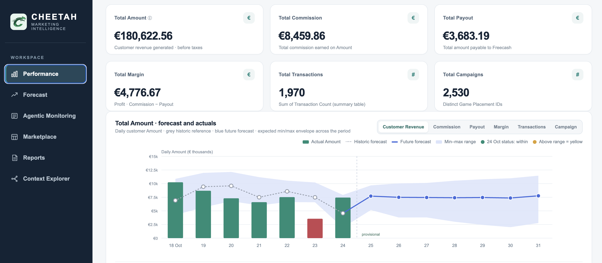
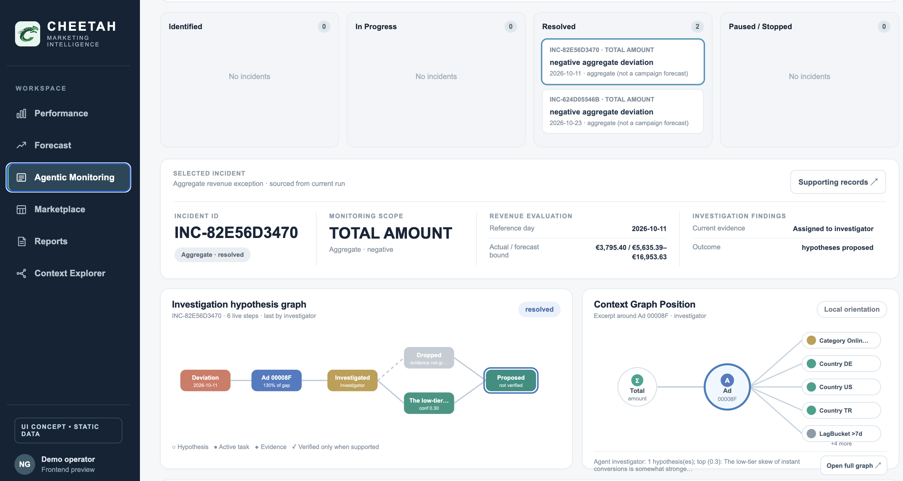
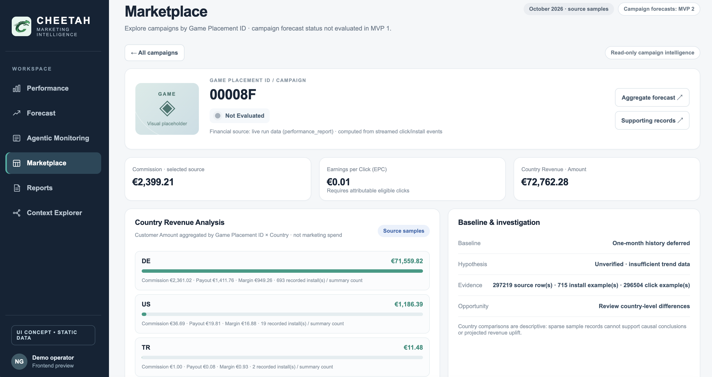

# HackLab-CHEETAH-Autonomous-Performance-Marketing-Intelligence
CHEETAH is a fully agentic performance marketing intelligence system that autonomously forecasts revenue, detects anomalies, investigates performance deviations, and delivers actionable insights through coordinated AI agents.

## Screenshots

**Performance** — live KPI tiles and the daily Amount against the locked forecast band (red bar = deviation outside the band).



**Agentic Monitoring** — incidents raised by the daily close, the investigator's hypothesis trail and the incident's position in the Neo4j context graph.



**Marketplace** — per-campaign (Game Placement ID) drill-down with live Commission, EPC and per-country revenue.



## Input event data

CHEETAH consumes a time-ordered stream of click and install (conversion) events. In `live_events`
mode the worker inserts each row as the simulated clock passes its `event_time_utc`; daily totals,
the Neo4j day layer, forecasts and deviation checks are all derived from these rows. Example rows
from `data/synthetic/full/raw/event_timeline.parquet` (synthetic, calibrated on the real Oct 2026
Freecash data; ~3.73M rows, of which ~2.6k installs):

| event_time_utc | kind | source_id | game_placement_id | country | amount | commission | payout | margin | vertical | category | event_day |
|---|---|---|---|---|---|---|---|---|---|---|---|
| 2026-10-01 00:00:06.846 | click | 9000097489 | 00008F | DE | | | | | Retail | Onlineshop | 2026-10-01 |
| 2026-10-01 00:00:09.738 | click | 9000075627 | 00008F | DE | | | | | Retail | Onlineshop | 2026-10-01 |
| 2026-10-01 05:37:08.845 | install | 9000005 | 00008F | DE | 30.00 | 2.00 | 0.250 | 1.750 | Retail | Onlineshop | 2026-10-01 |
| 2026-10-01 05:51:43.705 | install | 9000076 | 00008F | DE | 342.85 | 17.14 | 11.998 | 5.142 | Retail | Onlineshop | 2026-10-01 |

- `source_id` is the Click ID for clicks and the Transaction ID for installs; all IDs are strings.
- Money columns are only set on installs: `amount` is customer net revenue (excl. tax),
  `margin = commission − payout`.
- `vertical` / `category` are placement-level attributes, so clicks carry them too (when the
  placement is known).

# CHEETAH v1.5 — Integration Foundation

This package implements the approved FE-01–FE-10 **frontend design changes** and a runnable **backend simulation/event foundation**, while preserving all six original routes and the v1.4 original files outside this package.

## Included

- `frontend/CHEETAH_UI_Prototype_v1.5.html`: standalone enhanced UI with October aggregate-first UX, simulation controls, Evidence Reviewer panel, governed-action panel, two replay options, neutral campaign indicators, graph lifecycle legend and SSE/API integration. Original source samples remain explicitly marked as samples when offline — Forecast's event feed, the whole Reports screen (all five tabs), and the live half of Marketplace (tile list + campaign Commission/EPC/Country Revenue) switch to real live data the moment a run is connected; Marketplace's forecast-status pill and Baseline & investigation panel stay hardcoded by design (MVP 2 / Investigator scope).
- `PRD/Master_PDR_v2.0.pdf`/`.docx`: approved requirements, architecture, service contracts, acceptance cases and implementation limits (supersedes the older `CHEETAH_Product_and_Integration_Spec_v1.5.docx`, no longer in the repo). `PRD/PRD_findings_extension.md` logs decisions settled after it.
- `backend/app.py`, `models.py`, `core.py`, `worker.py`: FastAPI endpoints, SQLAlchemy models, durable command queue, October source/daily forecast ingestion, daily revenue evaluation, automatic pause, incident records, source-event batches and SSE.
- `docker-compose.yml`, `Dockerfile`, `.env.example`: local infrastructure for PostgreSQL, API, one worker and Neo4j (Neo4j model itself pending).
- `tests/test_backend.py`: smoke tests using isolated test-only values, not data included with the product.

## What works now

1. All six HTML screens render with no observed JS exceptions in Chromium smoke tests.
2. Persistent run creation, status snapshots, commands, run-specific SSE with event IDs.
3. Import and validate exactly 31 October daily Amount values under an immutable dataset ID.
4. Import clicks and installs as independent IDs and stream their per-day batches from the worker.
5. Import seven-day externally produced forecast outlooks and lock D+1 references (no rewriting).
6. Compare each finalized aggregate daily Amount to its locked interval; pause on a deviation and emit an aggregate incident.
7. Show an explicit blocked agent task if investigation credentials/model are absent; no fabricated root-cause/evidence outcomes.
8. UI displays unavailable/neutral statuses until the necessary integrations are configured.

## Not yet operational — dependencies expressly deferred by the product owner

- Actual October 2026 time-series and full click/install records; test data in `tests/` is isolated and never loaded into the UI. A **synthetic** (not real) stand-in dataset is available for demo/dev purposes only — see "Synthetic demo data" below.
- TabPFN-TS direct inference and interval calibration, because API credentials and historical context were not supplied.
- Claude Investigator and Evidence Reviewer inference, bounded ReAct and evidence reference tests.
- Neo4j/MCP model, graph proposal approval and learning commit.
- Sandbox action effects, guardrails, rollback, causal intervention mechanics.
- Checkpoint-backed Learning Replay and Fix Validation Replay. The API currently **rejects replay requests** until these adapters exist; frontend buttons accurately surface that state.
- Production authentication, concurrency hardening and deployment security.

~~True intra-day source-event staggering~~ — **now implemented** for the `live_events` ingestion
mode (see `backend/README.md`'s "Ingestion modes" section): the worker genuinely inserts each
click/install row as the simulated clock passes its real timestamp, not a per-day batch. The
original `preloaded_daily` mode (bulk-upload, day-filtered reveal) is unchanged and still the
default.

## Quick start

**With Docker:**
1. Copy `.env.example` to `.env`; set unique local passwords.
2. `docker compose up --build` from this directory. API/UI at `http://127.0.0.1:8000/`. Neo4j management interface at `localhost:7474` (present for future graph integration, not yet queried by the API).

**Without Docker** — needs a **Python 3.10+** venv (`app.py`'s `X | None` type hints fail on 3.9, even with `from __future__ import annotations`; see `backend/README.md`). The repo's `.venv-data` is pinned to 3.9 for `cheetah_synth`, so use a separate one:
1. One-time setup: `python3.10 -m venv .venv-backend && .venv-backend/bin/pip install -r backend/requirements.txt`
2. `./start_backend.sh` from the repo root (`chmod +x` it first if needed). This starts both the API (`uvicorn app:app --reload --port 8000`) and the worker (`worker.py` — actually executes queued commands and advances simulations; nothing runs without it) in one terminal, and stops both cleanly on `Ctrl+C` (or when the terminal closes). Before starting, it stops any leftover process still holding the agent scheduler lock (`var/agent_bus/locks/scheduler.lock`) or listening on the port. Once started, it waits for this worker's agent scheduler to report alive, and exits with a loud banner if it doesn't. Otherwise every agent would silently show "down" (set `CHEETAH_AGENTS=off` to run without agents and skip the check). Stop it with `Ctrl+C`, not `Ctrl+Z`: a suspended worker keeps the lock. It also **auto-pushes a fresh live demo run** once the API is reachable (a new timestamped `--dataset-id` every time, so restarts never collide) — open `http://127.0.0.1:8000/` right after and there's already something running; set `SKIP_AUTO_PUSH=1` to skip this and push manually instead (see "Test run" below).

Either way, once the server's up you need data loaded before a run can start: either real data (`POST /api/v1/datasets/daily` + `/api/v1/forecasts/outlooks`, 31 October records each — see `backend/README.md`) or the synthetic test run below (already handled automatically by `start_backend.sh` unless you set `SKIP_AUTO_PUSH=1`).

## Test run (synthetic demo data, not real data)

A ready-made way to exercise the full pipeline (ingest → daily playback → deviation detection →
pause/incident → blocked Investigator task) without real data. `data/synthetic/` (generated by
`src/cheetah_synth/`, see `data/synthetic/README.md`) holds a synthetic click→conversion journey
dataset calibrated against the real Oct 2026 reports in `data/`; `cheetah_synth` also includes an
adapter that pushes a generated run straight into this backend's own ingestion endpoints.

1. Start the server (see Quick start above) and confirm both the API and the worker are running.
2. Push the synthetic dataset and start a run, from the repo root — bulk `preloaded_daily` (below)
   or genuinely live, per-event `live_events` (`start_backend.sh`'s auto-push already does this
   for you; use a fresh `--dataset-id` either way, they're immutable):
   ```bash
   PYTHONPATH=src .venv-data/bin/python -m cheetah_synth.cli push-to-backend \
     --run-id full --dataset-id synth-full-v1 --start
   # or, for true live streaming (see backend/README.md's "Ingestion modes" section):
   PYTHONPATH=src .venv-data/bin/python -m cheetah_synth.cli push-to-backend \
     --run-id full --dataset-id synth-full-live-v1 --ingestion-mode live_events --start
   ```
   The first ingests all 31 daily amounts plus a downsampled ~5,260 click/install source events up
   front; the second streams every one of the ~3.7M real-shaped click/install rows in live, one
   small batch per tick, as the simulated clock passes each event's real timestamp. Either way it
   also pushes a naive placeholder forecast reference per day, creates a run, and queues `start` —
   prints the new `run_id` when done.
3. Open `http://127.0.0.1:8000/` in a browser (hard-refresh with Cmd+Shift+R if you'd loaded it
   before). The UI auto-opens the most recently created run, so this one loads automatically;
   the KPI tiles should populate and the daily chart should start advancing as the worker ticks
   through October.
4. Expect a pause around **Oct 7** — that's where the naive reference band (tuned to flag
   roughly one day across the month, not tied to any specific injected anomaly) detects a
   deviation, creating an Incident and a `blocked_configuration` Investigator task (Claude isn't
   connected, so it can't do more than flag that it's blocked). Send a `resume` command (the UI's
   toolbar button, or `POST /api/v1/runs/<run_id>/commands {"command":"resume"}`) to let playback
   continue to day 31.
5. For a `live_events` run specifically, check the **Reports** screen (all five tabs browse/filter/
   export real streamed rows — paginated via `GET /runs/{id}/source_events`, with Performance
   Report's `GET /runs/{id}/performance_report` rollup) and the **Marketplace** tile list/campaign
   detail page, both of which switch from static samples to this live data automatically once a run
   is connected.

Everything pushed this way is unambiguously marked synthetic in the data itself —
`source_kind="synthetic"` on daily amounts, `source="synthetic_naive_baseline"` /
`model_version="naive_trailing_median_v1"` on the forecast references (a deliberately naive
trailing-median placeholder, **not** a TabPFN forecast — TabPFN isn't connected, per "Not yet
operational" above) — so nothing from this path could be mistaken for real revenue or a real
model output. Re-running `push-to-backend` with the same `--dataset-id` fails with `409` (dataset
IDs are immutable) — pass a new `--dataset-id` for a fresh ingest, or just `POST /api/v1/runs
{"dataset_id":"synth-full-v1"}` directly to start another run against the already-loaded data.

## Data and metric protection

`Amount` is customer net revenue excluding tax, not spend or profit. Source summary aggregates and transaction detail must not be double counted. Preserve Click ID, Transaction ID, Freecash ID, Freecash AdSpace ID and Game Placement ID as strings. Campaign-level forecasting remains explicitly MVP 2.

## Change control

Original `/mnt/data/CHEETAH_UI_Prototype_v1.4(1).html` and `/mnt/data/CHEETAH_Frontend_PDR_v1.4_Data_Naming(1).docx` were left untouched. The v1.5 DOCX is a superseding **integration specification**, not a silent edit of the v1.4 33-page reference PDR. The original PDR remains the design authority for unchanged views and field definitions.
