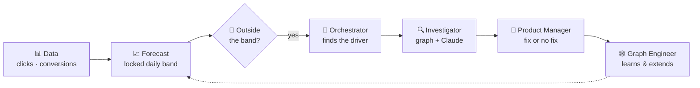

<div align="center">


# CHEETAH

### Autonomous Performance Marketing Intelligence

**It watches the marketplace, notices what changed, finds out why, and tells you what to do — before anyone asks.**


</div>

---

## ⚡ What it does

Dashboards wait for someone to look at them. CHEETAH doesn't wait.

- 🕸️ **Keeps a graph of the business.** Ads, countries, categories, conversion lag and metrics live in Neo4j. Agents extend it as they learn something new.
- 📈 **Forecasts every day.** Each day gets a TabPFN-TS forecast band, locked the day before so it can't be tuned after the fact.
- 🚨 **Detects what matters.** A day outside its band opens an incident and pauses the replay.
- 🔍 **Investigates on its own.** It narrows the deviation to the segment that drove it, reads the graph around it, and has Claude form hypotheses grounded in real numbers.
- 🧭 **Reports with evidence.** You get what changed, why it probably changed, what is at stake, and ranked actions. These are recommendations only; nothing is executed.

> **Honest by design.** When an integration is missing, CHEETAH reports *blocked* or *unknown*. It never invents a plausible-looking answer.

## 🔁 The loop



Every step streams live to the **Agentic Monitoring** screen. Click an anomaly to follow the agent through the graph as it works.

## 🦁 Meet the pack

| | Agent | Job |
|---|---|---|
| 🦒 | **Giraffe** | Simulation clock: replays October 2026 hour by hour |
| 🦌 | **Impala** | Watches pacing and auctions on paid traffic |
| 🐦 | **Oxpecker** | Searches the web for outages that hit our ads |
| 🎯 | **Anomaly Orchestrator** | Finds the segment behind a deviation and routes the incident |
| 🐺 | **Hyena** | Investigator: hypotheses backed by numbers from the graph |
| 🐊 | **Croc** | Product manager: decides *fix*, *no fix* or *monitor* through seven gates |
| 🐃 | **Buffalo** | Graph engineer: onboards new metrics and validates causal edges |

## 🚀 Quick start

```bash
python3.12 -m venv .venv-backend && .venv-backend/bin/pip install -r backend/requirements.txt
cp .env.example .env          # add ANTHROPIC_API_KEY, NEO4J_*, optional TABPFN_TOKEN
./start_backend.sh            # API + worker + a live demo run → http://127.0.0.1:3030
```

Prefer containers? `docker compose up --build` → `http://127.0.0.1:8000`.

## 🎬 The demo

1. **Inject a fault.** A pacing bug burns the budget by late morning → Impala flags it → Croc proposes the fix.
2. **Make an innocent change.** A planned promo lifts traffic 1.7×. Impala folds it into its baseline, so no false alarm fires.
3. **Add a new metric.** Buffalo validates it and finds its place in the graph without being told where.

Revenue anomalies in the replay pause the run and are investigated live. → [Demo guide](docs/70-demo.md)

## 📚 Learn more

| | |
|---|---|
| 🗺️ [Technical docs](docs/README.md) | Overview, data, backend, graph, agents, frontend, demo |
| 🧱 [Principles](docs/principles.md) | The rules that keep the output honest |
| 📐 [Architecture diagrams](PRD/architecture_diagrams/) | System context, runtime, agent workflow |
| 🛠️ [Operations](docs/01-operations.md) | Venvs, env vars, tests, health checks |

<div align="center">
<sub>Built at HackLab with real Freecash affiliate data from October 2026 · English everywhere · Recommendations only, never auto-executed</sub>
</div>


**Agentic Monitoring** — incidents raised by the daily close, the investigator's hypothesis trail and the incident's position in the Neo4j context graph.


**Marketplace** — per-campaign (Game Placement ID) drill-down with live Commission, EPC and per-country revenue.


## Input event data

CHEETAH consumes a time-ordered stream of click and install (conversion) events. In `live_events`
mode the worker inserts each row as the simulated clock passes its `event_time_utc`; daily totals,
the Neo4j day layer, forecasts and deviation checks are all derived from these rows. Example rows

| event_time_utc | kind | source_id | game_placement_id | country | amount | commission | payout | margin | vertical | category | event_day |
|---|---|---|---|---|---|---|---|---|---|---|---|
| 2026-10-01 00:00:06.846 | click | 9000097489 | 00008F | DE | | | | | Retail | Onlineshop | 2026-10-01 |
| 2026-10-01 00:00:09.738 | click | 9000075627 | 00008F | DE | | | | | Retail | Onlineshop | 2026-10-01 |
| 2026-10-01 05:37:08.845 | install | 9000005 | 00008F | DE | 30.00 | 2.00 | 0.250 | 1.750 | Retail | Onlineshop | 2026-10-01 |
| 2026-10-01 05:51:43.705 | install | 9000076 | 00008F | DE | 342.85 | 17.14 | 11.998 | 5.142 | Retail | Onlineshop | 2026-10-01 |

- `source_id` is the Click ID for clicks and the Transaction ID for installs; all IDs are strings.
- Money columns are only set on installs: `amount` is customer net revenue (excl. tax),
  `margin = commission − payout`.
- `vertical` / `category` are placement-level attributes, so clicks carry them too (when the
  placement is known).
