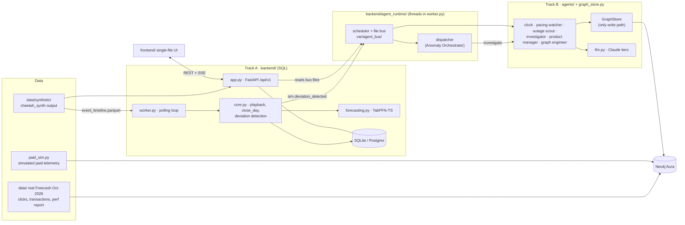

# 00 · Overview: structure and tech stack

CHEETAH is an agentic monitoring system for a performance-marketing marketplace (Freecash
affiliate ads, October 2026). It keeps a graph of how the business works, decides what to watch,
detects meaningful changes, investigates them on its own, and reports with evidence. Nobody has to
ask it a question. The brief is [`DESCRIPTION.md`](../DESCRIPTION.md).

This page owns **how the parts connect**. Each component's internals live in its category doc
(linked from every section below).

## 1. What the judges score, and where it lives

| Criterion | Weight | Where in the system | Read |
|---|---|---|---|
| Metric graph + automatic extension | 40% | Neo4j graph, `GraphStore`, Metric nodes with `FORMULA` / `INFLUENCES`, graph engineer onboarding | [40-graph](40-graph.md), [50-agents](50-agents.md#graph-engineer-buffalo) |
| Autonomous monitoring + investigation | 40% | Forecast band + deviation detection, pacing watcher, dispatcher, investigator, product manager | [30-forecasting-detection](30-forecasting-detection.md), [50-agents](50-agents.md) |
| Working demo | 20% | Simulated playback, injected faults and innocent changes, Agentic Monitoring tab | [70-demo](70-demo.md), [60-frontend](60-frontend.md) |

## 2. Two tracks, one system

The repo grew as two parallel tracks that are now wired together at a few seams.

- **Track A: simulation and detection.** A FastAPI backend replays October 2026 day by day (or
  event by event) from synthetic data, compares each closed day to a locked forecast band, and
  opens an `Incident` on a breach. Data lives in SQL (SQLite in dev, Postgres in Compose).
- **Track B: graph and agents.** A Neo4j graph built from the *real* Freecash data plus simulated
  paid-acquisition telemetry, and Claude-backed agents that watch it, investigate, propose fixes
  and extend the graph.

The agents of Track B run as scheduler threads **inside Track A's worker process**, so one
`worker.py` drives both.

## 3. The seams

These are the only places where components touch. Category docs describe each side; this table
is the single description of the contract between them.

| Seam | From → to | Contract | Owner docs |
|---|---|---|---|
| Synthetic data → backend | `cheetah_synth.backend_adapter` → `/api/v1/datasets/*`, `/forecasts/references`, `/runs` | HTTP POST; datasets are immutable per `dataset_id` | [10-data](10-data.md), [20-backend](20-backend.md) |
| Event timeline → worker | `event_timeline.parquet` → `core.advance_run_live` | Parquet file sorted by timestamp, path stored on the `Run` | [10-data](10-data.md), [20-backend](20-backend.md) |
| Day close → forecast | `core.close_day` → `forecasting.issue_forecast` | Runs after the close transaction; only D+1 is locked | [30-forecasting-detection](30-forecasting-detection.md) |
| Detection → agents | `core.close_day` → bus event `sim.deviation_detected` → dispatcher | Bus event; dispatcher writes `Incident` / `AgentTask` lifecycle back into SQL | [30-forecasting-detection](30-forecasting-detection.md), [50-agents](50-agents.md) |
| Agent ↔ agent | `backend/agent_runtime/bus.py` | Files in `var/agent_bus/`, message envelope, at-least-once | [50-agents](50-agents.md#communication) |
| Agents → graph | `agents/*` → `GraphStore` → Neo4j | Agents never write Cypher; `ag_*` props only on base data; every write is an undoable `Change` | [40-graph](40-graph.md#write-rules) |
| Agents → LLM | `agents/*` → `llm.claude_json` | One call → one JSON object; tier named per call; failure = `unknown` | [50-agents](50-agents.md#llm-access) |
| Backend → UI | `app.py` → browser | Snapshot + SSE outbox stream for runs; REST reads of bus files for agents | [20-backend](20-backend.md), [60-frontend](60-frontend.md) |
| UI → agents | `POST /agents/metrics`, `/agents/{name}/trigger`, `/agents/fixes/{id}/feedback` | API writes trigger/event/feedback files only; never touches threads | [50-agents](50-agents.md) |

Two things look like seams but are **not wired**: the API's `GET /context/graph` still returns
`unavailable` (the UI's Context Explorer does not read Neo4j), and the Track A "Inspector",
"Auditor" and "Mechanic" services are placeholders. See the Status section of each doc.

## 4. Life of an anomaly (the end-to-end thread)

One deviation, followed through every component. Each step links to the doc that owns it.

1. **Data arrives.** The worker streams synthetic clicks/installs into `SourceEvent` as the
   simulated clock passes their timestamps. → [20-backend](20-backend.md#ingestion-modes)
2. **The day closes.** `core.close_day` sums the day's `DailyAmount` and compares it with the
   `ForecastReference` locked the day before. → [30-forecasting-detection](30-forecasting-detection.md#detection)
3. **Breach.** Outside the band: the run pauses, an `Incident` is created and
   `sim.deviation_detected` goes on the bus. → [30-forecasting-detection](30-forecasting-detection.md#detection)
4. **Routing.** The dispatcher finds the narrowest segment (placement → category → country) that
   explains at least half of the gap and sends an `investigate` message. → [50-agents](50-agents.md#dispatcher-anomaly-orchestrator)
5. **Investigation.** The investigator reads graph context, computes deviations against peers, and
   asks Claude for hypotheses. Every evidence line must quote a number from the context. Result:
   `(Hypothesis)-[:ABOUT]->(…)` in Neo4j. → [50-agents](50-agents.md#investigator-hyena), [40-graph](40-graph.md)
6. **Close-out.** The dispatcher marks the incident `resolved` with `evidence_outcome` =
   `hypotheses_proposed` or `inconclusive` (never "root cause verified").
7. **Fix discussion.** The product manager runs one discussion per issue: playbook candidate,
   stances from the other agents, seven deterministic gates → `fix_proposed` / `no_fix` /
   `graph_only` / `monitor`, plus a business brief. → [50-agents](50-agents.md#product-manager-croc)
8. **Graph learns.** If the discussion relied on an `INFLUENCES` edge, the graph engineer is asked
   to validate it. → [40-graph](40-graph.md#metric-layer)
9. **People see it.** The UI shows the incident lifecycle, agent status, briefs and fixes; a human
   can accept or reject a fix, which feeds back to the product manager. → [60-frontend](60-frontend.md)

A parallel path runs without any SQL involvement: the clock ticks, the **pacing watcher** reads
hourly paid telemetry from Neo4j and writes `Signal` nodes, which feed steps 5–9 directly.

## 5. Tech stack

| Layer | Technology | Used for | Where |
|---|---|---|---|
| Language | Python 3.10+ (backend, agents; 3.12 in practice), 3.9+ (synthetic generator) | everything server-side | three venvs, see [01-operations](01-operations.md) |
| API | FastAPI, Uvicorn, Pydantic v2, Server-Sent Events | REST + live event stream | `backend/app.py` |
| Persistence | SQLAlchemy 2; SQLite (dev, WAL) / Postgres 16 (Compose) via psycopg 3 | runs, inputs, forecasts, incidents, outbox | `backend/models.py` |
| Graph | Neo4j 5 (Aura in practice), `neo4j` Python driver, `neo4j-cli` fallback | business graph, metric graph, agent findings, audit trail | `graph_store.py`, `*.cypher` |
| Forecasting | TabPFN-TS (`tabpfn-time-series`, cloud mode) | daily Amount forecast band | `backend/forecasting.py` |
| LLM | Anthropic SDK, Claude Haiku / Sonnet / Opus 5.5 tiers, server-side web search | hypotheses, reviewers, outage research, stances, briefs | `llm.py` |
| Data processing | pandas, numpy, pyarrow, openpyxl | calibration, generation, Parquet timelines, xlsx export | `src/cheetah_synth/` |
| Agent runtime | stdlib threads + file bus with atomic `os.replace` writes, `flock` singleton | scheduling and messaging | `backend/agent_runtime/` |
| Frontend | one standalone HTML/CSS/JS file, `fetch` + `EventSource` | six screens | `frontend/CHEETAH_UI_Prototype_v1.5.html` |
| Infra | Docker Compose (Postgres, Neo4j, api, worker) | containerised run | `docker-compose.yml`, `Dockerfile` |
| Tests | pytest, httpx | backend, runtime, agents, generator | `tests/` |

## 6. Repository map

| Path | Track | What | Doc |
|---|---|---|---|
| `backend/app.py`, `core.py`, `models.py`, `worker.py`, `env.py` | A | API, domain logic, schema, worker loop | [20-backend](20-backend.md) |
| `backend/forecasting.py`, `forecast_backtest.py` | A | TabPFN-TS service and backtest | [30-forecasting-detection](30-forecasting-detection.md) |
| `backend/agent_runtime/` | A↔B | scheduler, bus, dispatcher, health, agent read API | [50-agents](50-agents.md) |
| `src/cheetah_synth/` | A | synthetic generator and backend adapter | [10-data](10-data.md) |
| `frontend/` | A | UI | [60-frontend](60-frontend.md) |
| `agents/` | B | agent implementations and role specs | [50-agents](50-agents.md) |
| `graph_store.py`, `llm.py` | B | graph write path, Claude helper | [40-graph](40-graph.md), [50-agents](50-agents.md) |
| `paid_sim.py`, `paid_metrics.py`, `*.cypher` | B | paid telemetry simulator, metric graph seed, generated Cypher | [40-graph](40-graph.md) |
| `run_agents.py` | B | one manual agent pass | [50-agents](50-agents.md) |
| `service_down_agent.py`, `metrics_monitor_agent.py` | B | **legacy**, don't extend | [50-agents](50-agents.md#status) |
| `graph_build_proposal.md`, `graph_build_proposal.cypher` | — | reference only, not the architecture | [40-graph](40-graph.md) |
| `tests/` | both | pytest suites | [01-operations](01-operations.md#tests) |
| `PRD/` | — | requirements, decision log, target diagrams | [README](README.md#source-documents) |
| `data/` | — | real inputs (read-only), synthetic output (gitignored) | [10-data](10-data.md) |
