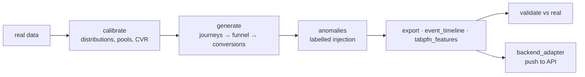

# 10 · Data: real inputs, synthetic generator, contracts

## Purpose and judging relevance

The brief provides no dataset. CHEETAH uses one month of **real** Freecash affiliate data as the
business ground truth, plus two simulators that add what the real data lacks: a playable,
anomaly-injected journey stream (for Track A's detection loop) and hourly paid-acquisition
telemetry (for the pacing watcher). This underpins the demo (20%) and gives the graph real
structure to reason over.

## Where it lives

| Path | What |
|---|---|
| `data/Clicks/*.csv` | 31 daily click logs (read-only) |
| `data/OCT26_Transaction Report.xlsx` | ~3k real conversions (read-only) |
| `data/OCT26_Performance-Report.xlsx` | monthly rollup per AdSpace × placement × country (read-only) |
| `src/cheetah_synth/` | synthetic journey generator (Track A) |
| `data/synthetic/<run_id>/` | generator output, gitignored, regenerable |
| `paid_sim.py`, `paid_metrics.py` | paid telemetry simulator and its metric graph (Track B), see [40-graph](40-graph.md) |

## Real data

| File | Grain | Key columns |
|---|---|---|
| Clicks | one row per click | `Click ID, Time, Freecash ID, Freecash AdSpace ID, Game Placement ID, Country` |
| Transaction Report | one row per conversion | click and conversion time, lag (s), type (install / sale / lead), `Amount, Commission, Payout, Margin` |
| Performance Report | AdSpace × placement × country, whole month | vertical, category, currency labels |

Join keys: `Freecash ID`, `Freecash AdSpace ID`, `Game Placement ID`, `Country`.

Quirks every consumer must handle:
- Click `Time` is ISO 8601 with mixed sub-formats → `pd.to_datetime(..., format="ISO8601")`.
- CSV re-exports of the xlsx files use thousands separators (`"1,101.98"`).
- Overall conversion rate is ~0.083%, so most slices are small samples.
- Conversions lag clicks by up to 7+ days: the most recent days are always incomplete.
- Only one month exists, so baselines must work without a prior period (trailing 7-day,
  weekday-adjusted median).

Data contracts (IDs as strings, Amount semantics, provenance tags) are in
[principles](principles.md#9-data-contracts).

## Synthetic journey generator (`cheetah_synth`)

| Stage | Module | Output |
|---|---|---|
| Load | `real_data.py` | real frames |
| Calibrate | `calibration.py` | empirical distributions, bootstrap pools, per-segment CVR (Beta-Binomial shrinkage), placement metadata |
| Generate | `journeys.py`, `funnel.py`, `identities.py`, `surfaces.py` | journeys, invented funnel events, synthetic ID ranges |
| Inject | `anomalies.py` | labelled anomalies (`build_default_catalog`) |
| Export | `export.py`, `event_timeline.py`, `tabpfn_features.py` | files in the real reports' shapes, `event_timeline.parquet` (one row per click/install, sorted), daily feature table |
| Check | `validate.py` | `validation_report.{json,md}` |
| Deliver | `backend_adapter.py` | datasets, forecast references and a `Run` in the backend |

**Daily profile.** The default `flat` profile pins daily clicks to the calibrated mean and daily
Amount near the month median (~3% noise), so injected anomalies stand out against a naive band.
`calibrated` keeps the real ~45% day-to-day variation.

**Default anomaly catalog** (whole-day, resolved against the day's revenue mix):

| Day | Anomaly | Effect | Target |
|---|---|---|---|
| Oct 7 | `postback_outage` | −45% | top country |
| Oct 14 | `advertiser_rate_cut` | −40% | top vertical |
| Oct 20 | `promo_surge` | +60% | top placement |
| Oct 27 | `tracking_break` | −35% | top placement |

**Delivery modes** (`backend_adapter`): `push_run_to_backend` (mode `preloaded_daily`) posts daily
amounts, events and references; `register_live_run` (mode `live_events`) only posts references and
points the run at `event_timeline.parquet`, so the worker streams events itself. Both post a
placeholder band, `naive_trailing_median_v1`: trailing 7-day median ± max(4·MAD-sigma, 15%).
This seam is described in [00-overview](00-overview.md#3-the-seams).

## Paid telemetry simulator (`paid_sim.py`)

The real data has no budgets, bids, auctions, impressions or spend. `paid_sim.py` simulates them
hourly for the top 6 real ads × their top 2 countries × device OS over 14 days, anchored on real
revenue per conversion. It models a pacing controller, an auction (win rate vs bid multiplier and
competition) and tracking completeness, and injects four scenarios on the last day:
`pacing_bug` (fault), `competitor_pullback` (fault), `planned_promo` (innocent change, with a
`PlannedEvent` node) and `tracking_loss` (data issue). Output is Cypher, loaded into Neo4j; see
[40-graph](40-graph.md#how-it-works-four-layers-in-one-graph) and [70-demo](70-demo.md).

## Interfaces

| Produces | Consumed by |
|---|---|
| `data/synthetic/<run>/raw/event_timeline.parquet` | backend worker (`live_events`) |
| HTTP POSTs to `/datasets/daily`, `/datasets/events`, `/forecasts/references`, `/runs` | backend API |
| `paid_graph.cypher`, `freecash_graph.cypher` | Neo4j load |

CLI (`cli.py`, defaults in `config.py`): `calibrate`, `generate`, `validate`, `all`, `build-timeline`, `push-to-backend`. Commands are
in [01-operations](01-operations.md).

## Status

| Built | Stubbed / deferred |
|---|---|
| Calibration, generation, anomaly injection, export, validation, both delivery modes | Real October data is never loaded into the backend or UI (only synthetic runs) |
| Paid telemetry simulator with four scenarios | `paid_sim.py` imports `freecash_graph.py`, which is not on `main` |
| | The naive forecast band is a placeholder, not a model |

Track B's graph stays on real data and Track A plays synthetic data. That split is a recorded
decision, see `PRD/PRD_findings_extension.md`.

## Deep dives

- [`data/synthetic/README.md`](../data/synthetic/README.md): generation process, current result, next steps
- [`ARCHITECTURE.md` §3, §4A](../ARCHITECTURE.md): generator modules and dataflow
- [`PRD/PRD_findings_extension.md`](../PRD/PRD_findings_extension.md): synthetic-vs-real scope decisions
