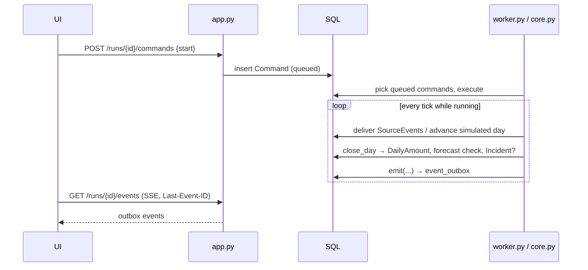

# 20 · Backend: simulation, persistence, API, event stream

## Purpose and judging relevance

The backend is the clock and the record of the demo: it replays October 2026, stores every input
and finding in SQL, closes each day, and streams every state change to the UI. Detection itself
(what happens at day close) is owned by [30-forecasting-detection](30-forecasting-detection.md);
the agent runtime that shares the worker process is owned by [50-agents](50-agents.md).

## Where it lives

| File | Responsibility |
|---|---|
| `backend/app.py` | HTTP surface: validates and stores inputs, queues commands, serves snapshot, SSE and live queries, exposes agent bus files. Never advances a simulation |
| `backend/core.py` | All domain logic: playback (both modes), `close_day`, command execution, `emit` to the outbox |
| `backend/models.py` | SQLAlchemy schema, engine, SQLite pragmas, stale-schema self-heal |
| `backend/worker.py` | One loop every ~100 ms: execute up to 10 queued commands, advance every running run, host the agent scheduler |
| `backend/env.py` | Loads repo-root `.env` |

## How it works

### Ingestion modes

| | `preloaded_daily` | `live_events` |
|---|---|---|
| Inputs | whole month posted up front (`/datasets/daily`, `/datasets/events`) | only forecast references posted; worker reads `event_timeline.parquet` |
| Advance | reveals stored rows one simulated day per tick | continuous `sim_clock_utc`; streams each event as the clock passes its timestamp |
| DailyAmount | supplied | computed by the worker when the day's 24 h window closes |
| Speed range | 0.5–60 s/day | 3–60 s/day (default 5 s/day ≈ 2.6 min per month) |

Live mode is benchmarked at ~129k inserts/s against ~3.7M events; 3 s/day needs ~74k/s at the
real peak hour. The loaded timeline is cached per run (`core._live_timelines`, LRU, evicted on
terminal state); an evicted or restarted run rebuilds its cursor by COUNT.

### Run state machine

`created → running ⇄ paused → completed | stopped | failed`. A deviation pauses the run with
reason `anomaly_detected`; `step` advances one day from `paused`. Full diagram:
[`ARCHITECTURE.md` §5](../ARCHITECTURE.md#5-run-state-machine).

### Event delivery

Every state change is written with `core.emit` to `event_outbox` and streamed over SSE with
`Last-Event-ID` resumption. The UI builds its state from `snapshot` + the stream and never polls
domain tables for run state. The stream carries samples; full data stays in tables. Event types:
[`ARCHITECTURE.md` §6](../ARCHITECTURE.md#6-outbox-event-types).

## Interfaces

**Tables** (`models.py`): inputs `daily_amounts`, `source_events`; forecasts `forecast_references`,
`forecast_values`; run state `runs`, `commands`; `event_outbox`; incidents `incidents`,
`agent_tasks`, `actions` (schema only); live KPIs `run_metrics`, `run_campaigns_seen`.

**Endpoints** (`/api/v1`):

| Group | Endpoints |
|---|---|
| Runs | `GET/POST /runs`, `GET /runs/{id}/snapshot`, `POST /runs/{id}/commands`, `GET /runs/{id}/commands/{cid}`, `GET /runs/{id}/events` (SSE) |
| Ingest | `POST /datasets/daily`, `/datasets/events`, `/forecasts/references`, `/forecasts/outlooks` |
| Live queries | `GET /runs/{id}/source_events` (filters, keyset pagination, `format=csv`), `/performance_report`, `/forecasts`, `/incidents`, `GET /incidents/{id}/tasks` |
| Agents | `GET /agents/status`, `/agents/messages`, `/agents/events`, `/agents/briefs`, `/agents/discussions`, `/agents/fixes`, `/agents/decisions`, `/agents/{name}/runs`; `POST /agents/events`, `/agents/metrics`, `/agents/{name}/trigger`, `/agents/fixes/{id}/feedback` |
| Stubs | `POST /runs/{id}/replays` (409), `GET /runs/{id}/replays/comparison`, `GET /context/graph` (unavailable), `GET /health` |

The agent endpoints only read and write bus files through `backend/agent_runtime/api.py`; see
[50-agents](50-agents.md#communication).

`performance_report` derives `conversion_rate`, `ecpc` and `roas` live with the same formulas as
`cheetah_synth/export.py` (the real report leaves them empty); `ecpm`, `ctr` and Freecash IDs stay
`null`.

## Configuration

`DATABASE_URL` (default SQLite, single worker only), `CORS_ORIGINS`. SQLite runs in WAL mode and
deletes and rebuilds `cheetah_dev.db` when the schema is stale (`_recreate_if_schema_stale`, never on
Postgres; there is no migration tooling). See [01-operations](01-operations.md).

## Status

| Built | Stubbed / deferred |
|---|---|
| Both playback modes, command queue, outbox/SSE, live KPIs, live reports, incident + task records, agent bus API | Learning Replay and Fix Validation Replay (`409`) |
| | `actions` table is never written (no sandbox fixes) |
| | `/context/graph` does not query Neo4j |
| | Production auth and multi-worker concurrency hardening |

## Deep dives

- [`ARCHITECTURE.md`](../ARCHITECTURE.md) §3–§8: tables, dataflows B–G, state machine, event types,
  deployment. §1, §2 and §10 predate Track B's merge: Neo4j *is* now queried, by the agents in the
  worker, not by the API.
- [`backend/README.md`](../backend/README.md): ingestion modes, reports endpoints, smoke test
- `PRD/Master_PDR_v2.0.pdf`: requirements and acceptance criteria
