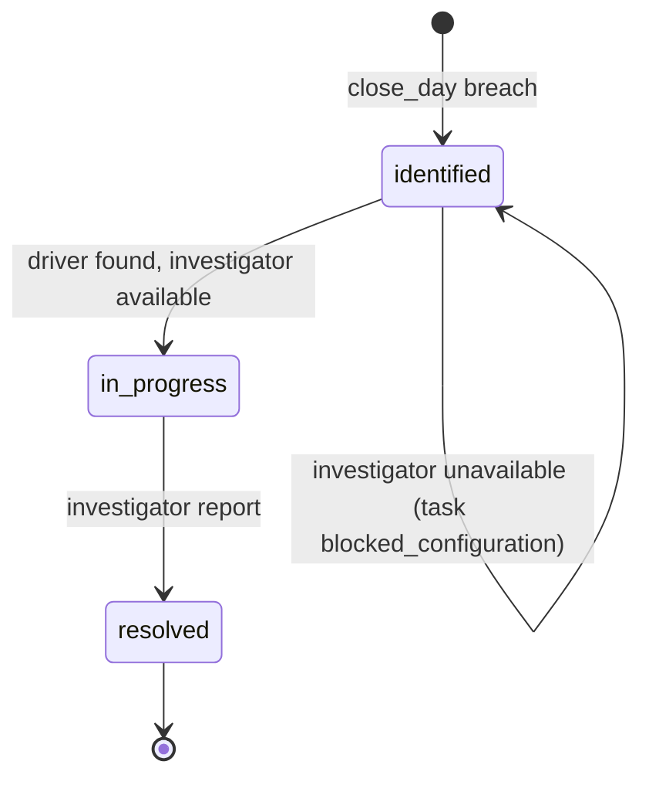

# 30 · Forecasting and detection: expected behaviour, deviations, routing

## Purpose and judging relevance

"Monitor continuously. Establish expected behaviour and detect changes worth investigating.
Consider seasonality, data completeness and planned events." This doc covers the three detectors
and how a detection becomes an investigation (part of the 40% monitoring criterion). The agents
that investigate are in [50-agents](50-agents.md).

| Detector | Watches | Expected behaviour | Grain | Data |
|---|---|---|---|---|
| **Deviation detector** (Track A, `core.close_day`) | daily total Amount | locked forecast band (TabPFN-TS or naive) | aggregate, per day | SQL, synthetic |
| **Pacing watcher** (`agents/pacing_watcher.py`) | spend, pacing, auction, CTR/CPC/CVR, tracking | same-hour median of prior ≤7 days × weekday × planned-event lift | ad × country, sliced by device / hour / channel, hourly | Neo4j, simulated paid telemetry |
| **Outage scout** (`agents/outage_agent.py`) | external services the ads depend on | "not reported down" | country / service | web search |

## Where it lives

| File | Role |
|---|---|
| `backend/forecasting.py` | TabPFN-TS forecast service (FC-01) |
| `backend/forecast_backtest.py` | MAE / WAPE / coverage / bias over historical cutoffs |
| `src/cheetah_synth/backend_adapter.py::build_naive_references` | placeholder band |
| `backend/core.py::close_day` | detection and incident creation |
| `backend/agent_runtime/dispatcher.py` | incident routing and lifecycle |
| `agents/pacing_watcher.py` | hourly paid monitoring, `Signal` nodes |

## How it works

### Forecast bands

Two forecast objects, deliberately separate:
- **`ForecastReference`**: the band for day D, issued on D−1 and then **locked**. Detection only
  ever compares against this.
- **`ForecastValue`**: one day of a 7-day outlook. Shown in the UI, never used for detection.

Providers (`Run.forecast_provider`):

| Provider | How the band is made | Notes |
|---|---|---|
| `naive` | trailing 7-day median ± max(4·MAD-sigma, 15%) | tagged `synthetic_naive_baseline`; sized for the `flat` daily profile |
| `tabpfn` | TabPFN-TS cloud mode, context = last 7 closed days, horizon 7; P10/P50/P90 → lower/point/upper; only D+1 locked | 7-day warm-up; missing token / package or provider error → `forecast.unavailable`, **no fallback** |

The forecast runs after the day-close transaction commits (`core.forecast_after_close`), at every
day rollover (`forecast.requested`).

### Detection

At day close, `close_day` emits `revenue.daily_finalized` and loads the day's locked reference:
- no reference → `forecast.reference_unavailable` (no guess);
- inside → `forecast.evaluated` (`within`);
- outside → `Incident` (direction `negative` / `positive`), run paused (`anomaly_detected`),
  `deviation.detected` + `simulation.paused` on the outbox, and **`sim.deviation_detected` on the
  agent bus**. If the bus is unavailable, the task is recorded as `blocked_configuration` instead.

### Routing (dispatcher, "Anomaly Orchestrator")

`dispatcher.find_driver` compares the day's install Amount per segment with that segment's
trailing 7-day median, narrowest dimension first (placement → category → country). The first
segment explaining ≥ 50% of the gap is the target; otherwise the one with the largest share. The
investigator gets an `investigate` message with the driver; its report closes the incident with
`evidence_outcome` = `hypotheses_proposed` (top hypothesis summarised) or `inconclusive`.

Every real step of the investigation (routed / no driver / blocked, investigator context, reasoning,
hypothesis, dropped evidence, concluded) is emitted as an `investigation.step` outbox event
(`dispatcher.emit_step`, or `record_step` for the investigator, which has no DB session) and returned
in the snapshot's `steps`. The UI's incident trail is drawn only from these.

### Pacing watcher (one cycle per `clock.tick`)

1. **Completeness first**: tracking completeness < 0.9 in the last 3 hours → data-completeness
   signal, no other checks on that slice, open signals not resolved.
2. **Baseline**: same hour window on prior ≤7 days (min 3), median × weekday factor × active
   `PlannedEvent` lift; robust MAD spread in log space with a floor.
3. **Pacing**: spend share vs baseline share at this hour, budget-exhaustion hour, 3-hour
   projection, and whether bids kept rising while ahead of plan.
4. **Auction decomposition**: spend = auctions × win rate × CTR × CPC in log space, so each
   component's share of the change is explicit; win rate moving *with* bids = bid-driven, *without*
   = external pressure.
5. **Significance**: both z ≥ 3 and ≥ 20% change; small-volume checks skipped.
6. **Dedup**: issue key = metric + ad + country; unchanged signals are not re-reported, changes
   update the node, clean slices resolve.

Signals go to the product manager as `report`s; ones that need a cause go to the investigator.

## Interfaces

| Emits | Where |
|---|---|
| `forecast.requested`, `forecast.updated`, `forecast.unavailable`, `forecast.evaluated`, `forecast.reference_unavailable`, `deviation.detected`, `simulation.paused`, `agent.task_updated`, `incident.updated`, `investigation.step` | SQL outbox → SSE |
| `sim.deviation_detected`, `sim.day_closed` | agent bus events |
| `Incident`, `AgentTask` rows | SQL |
| `(:Signal)` nodes, `-[:ON_METRIC]->Metric`, `-[:ABOUT]->Ad`, `-[:IN_COUNTRY]->Country` | Neo4j via `GraphStore.add_signal` |

## Configuration

`TABPFN_TOKEN` + `backend/requirements-forecast.txt`; `FORECAST_PROVIDER` for `start_backend.sh`;
`FORECAST_HORIZON_DAYS`, `FORECAST_CONTEXT_DAYS`, `FORECAST_WARMUP_DAYS` in `forecasting.py`;
watcher thresholds are constants at the top of `agents/pacing_watcher.py`.

## Status

| Built | Stubbed / deferred |
|---|---|
| Locked-band detection, TabPFN-TS for the aggregate, naive band, dispatcher routing and lifecycle, pacing watcher | Per-segment / per-metric detection in Track A (only the aggregate Amount is checked; the dispatcher localises after the fact) |
| | Per-placement forecasts and interval calibration (MVP 2) |
| | A continuous monitor over the *real* affiliate data (the pacing watcher covers simulated paid telemetry only) |
| | Track A "Inspector" / "Auditor" services remain placeholders; the dispatcher + Track B investigator replace them |

## Deep dives

- [`ARCHITECTURE.md` §4E](../ARCHITECTURE.md): day close and deviation detection dataflow
- [`PRD/PRD_findings_extension.md`](../PRD/PRD_findings_extension.md): TabPFN-TS decisions and backtest result
- [`AGENTS.md`](../AGENTS.md): pacing watcher summary
- `PRD/CHEETAH_ANOM01_Multi_Signal_Agentic_Monitoring_PRD_v1.0.pdf`: multi-signal monitoring requirements
