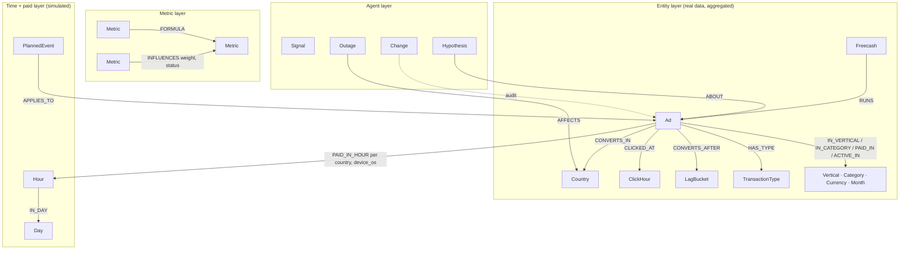

# 40 · Graph: Neo4j model, metric layer, write rules

## Purpose and judging relevance

The graph is CHEETAH's understanding of how the business works, and it carries 40% of the score:
"Build and maintain its metric graph … give relationships clear meanings … when a new metric
arrives, an agent identifies its connections, validates them and incorporates it." The Neo4j graph
is **the** graph; `graph_build_proposal.md` and `../hacklab/graphwalk` are reference only.

## Where it lives

| File | Role |
|---|---|
| `freecash_graph.cypher` | entity layer from real data (generated by `freecash_graph.py`, see Status) |
| `paid_sim.py` → `paid_graph.cypher` | time + paid telemetry layer, plus scenarios |
| `paid_metrics.py` | metric layer seed: `Metric` nodes, `FORMULA` and `INFLUENCES` edges |
| `graph_store.py` | the only write path for agents; read guard; audit and undo |
| `agents/graph_engineer_agent.py` | metric onboarding and edge validation, see [50-agents](50-agents.md#graph-engineer-buffalo) |

## How it works: four layers in one graph

1. **Entity layer.** One node per Ad, Country, Category, … and **no node per click or
   transaction**: rows are summed onto edges (`tx`, `amount`, `commission`, `payout`, `margin`).
   Graph size scales with ads × buckets. Every aggregate edge out of an Ad carries the same totals,
   so any dimension can slice them.
2. **Time and paid layer.** `Day` and `Hour` nodes; `PAID_IN_HOUR` edges carry hourly telemetry
   (auctions, impressions, clicks, spend, conversions, revenue, bid multiplier, tracking) per
   country and device. `PlannedEvent` marks intended changes so monitoring can discount them.
3. **Metric layer.** `(:Metric {id, definition, unit, cypher_value, domain})`. `cypher_value` is
   an expression over summed edge totals (e.g. `spend / clicks`), so every metric is evaluated the
   same way for any slice. Edges have explicit semantics:
   - **`FORMULA`**: exact arithmetic decomposition (`Paid Clicks = Ad Impressions * CTR`). Valid
     only if the residual is ≤ 1e-6 globally and in every slice.
   - **`INFLUENCES`**: possible cause with a prior weight and status `hypothesis` → `validated` /
     `rejected` (read as `coalesce(ag_status, status)`).
   - Breakdown by dimension is not a separate edge type: it is the entity layer itself.
4. **Agent layer.** `Signal`, `Hypothesis`, `Outage` nodes, `ag_*` annotations, and the `Change`
   audit trail.

### Metric layer

Seeded by `paid_metrics.py` (paid funnel: Eligible Auctions → Impressions → Clicks → Spend /
Conversions → Revenue, plus the pacing controller and tracking health). **Automatic extension**:
a contributor submits `{id, definition, unit, cypher_value, source_query?}` via
`POST /api/v1/agents/metrics`; the graph engineer evaluates it, finds `FORMULA` candidates by
residual testing and `INFLUENCES` candidates through an LLM mechanism plus an independent reviewer,
and writes the metric with `GraphStore.add_metric` / `link_metrics`. The contributor never chooses
its place in the graph. Procedure: [`agents/graph_engineer.md`](../agents/graph_engineer.md).

### Write rules

Enforced in `graph_store.py`, not by convention:

| Target | Agents may | Agents may not |
|---|---|---|
| Base nodes (`BASE_LABELS`) | set `ag_*` properties | change any other property, create or delete |
| Aggregate edges (`AGGREGATE_RELS`) | set `ag_*` (e.g. `ag_weight`); "remove" = `ag_disabled = true` | change totals |
| Agent edges (other UPPER_SNAKE_CASE types) | create, reweight (weight in [-1, 1]), delete | — |
| Agent nodes (`AGENT_LABELS`: Outage, Hypothesis, Signal) | create, update, set status (`open/resolved/confirmed/rejected`), delete | — |
| Metrics | onboard new ones (`origin='onboarding'`) | redefine build-owned metrics |
| `Change` nodes | — | modify |

Every write creates a `(:Change)` node; `undo(change_id)` reverts it. `GraphStore.read()` rejects
any Cypher containing write clauses. Re-running the build only MERGEs nodes and SETs totals, so agent
data survives a rebuild.

## Interfaces

`GraphStore` API: `read`, `get`, `exists`, `get_edge`, `set_props`, `add_outage`, `add_hypothesis`,
`add_signal`, `update_agent_node`, `set_status`, `delete_node`, `add_edge`, `set_edge_props`,
`reweight_edge`, `remove_edge`, `add_metric`, `link_metrics`, `undo`.

Adding a base label or relationship type means updating `BASE_LABELS` / `AGGREGATE_RELS` /
`AGENT_LABELS` in `graph_store.py` **and** the graph model description in the overlooker's
`SYSTEM` prompt.

## Configuration

`NEO4J_URI`, `NEO4J_USERNAME`, `NEO4J_PASSWORD`, `NEO4J_DATABASE` (Aura). Without them the store
shells out to `neo4j-cli` with credential `test`. Load commands: [01-operations](01-operations.md#loading-the-graph-track-b).

## Status

| Built | Stubbed / deferred |
|---|---|
| Entity layer (committed Cypher), time + paid layer, paid metric layer, write guard, audit/undo, metric onboarding, `INFLUENCES` validation | `freecash_graph.py` is not on `main` (branch `agents-neo4j-graph`); `paid_sim.py` imports it |
| | Per-day aggregate edges for the *real* affiliate data (`Ad-[:ON_DAY]->Day`) |
| | Affiliate-side metrics still live as Cypher in `agents/investigator_agent.py` (`AD_METRICS_Q`), not as Metric nodes |
| | API `GET /context/graph` and the UI Context Explorer don't read Neo4j |

## Deep dives

- [`agents/graph_engineer.md`](../agents/graph_engineer.md): metric spec, onboarding, re-link, validation
- [`CLAUDE.md`](../CLAUDE.md) "Track B": schema, principles, planned extensions
- `.agents/skills/`: Neo4j Cypher and modelling reference
- [`graph_build_proposal.md`](../graph_build_proposal.md): reference ideas only
