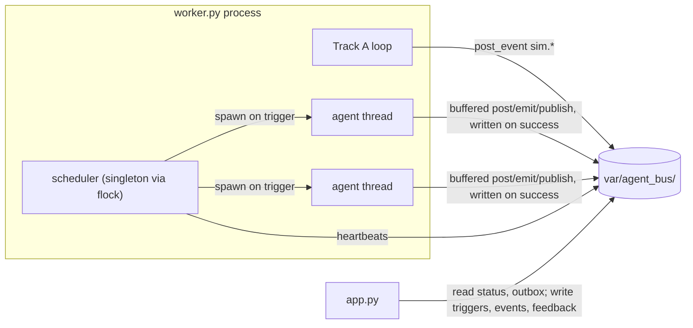

# 50 · Agents: roster, runtime, communication, LLM use

## Purpose and judging relevance

The agents close the loop from detection to report without a human asking: they decide where to
look, investigate, weigh fixes and extend the graph. This carries the "autonomous monitoring and
investigation" 40% and the "automatic extension" half of the graph 40%.

## Where it lives

| Path | Role |
|---|---|
| `agents/*.py` | agent implementations (Track B): `pacing_watcher.py`, `outage_agent.py`, `investigator_agent.py`, `product_manager_agent.py`, `graph_engineer_agent.py`, `graph_overlooker.py`, `stances.py` |
| `agents/*.md` | role specs: product manager, graph engineer, fix playbook, orchestration plan |
| `backend/agent_runtime/scheduler.py` | runs agents as threads on triggers, buffers outputs, heartbeats |
| `backend/agent_runtime/bus.py` | file bus in `var/agent_bus/` |
| `backend/agent_runtime/builtin.py` | agent registry (`default_specs`) and thin adapters around `agents/` |
| `backend/agent_runtime/dispatcher.py` | incident routing (Track A → B) |
| `backend/agent_runtime/health.py`, `api.py` | status derivation and the read side used by `app.py` |
| `llm.py` | the only way agents call Claude |
| `run_agents.py` | one manual pass outside the scheduler (outage → pacing → investigator → overlooker) |

## Roster

Display names are the ones in `builtin.py` (shown in the UI). [`AGENTS.md`](../AGENTS.md) uses an
older naming (Chronos, Pacer, Sentinel, Sleuth, Compass, Cartographer); the agent ids are the same.

| Agent id | Name | Role | Trigger | Needs | LLM |
|---|---|---|---|---|---|
| `sim_clock` | Giraffe | advance shared simulated clock one hour, broadcast `clock.tick`; manual jump to a scenario hour | interval | — | none |
| `pacing_watcher` | Impala | paid pacing & auction monitor, writes `Signal`s | `clock.tick` | Neo4j | none |
| `outage_agent` | Oxpecker | web research: are services the ads depend on down? writes `Outage`, `ag_risk*` | `clock.tick` | Neo4j + Claude | medium + web search |
| `dispatcher` | Anomaly Orchestrator | route Track A incidents to the investigator, track lifecycle | `sim.deviation_detected`, inbox | SQL | none |
| `investigator` | Hyena | investigate one target, write `Hypothesis` with quoted evidence | inbox | Neo4j + Claude | large |
| `product_manager` | Croc | triage, fix discussions, business brief | inbox | Neo4j (Claude optional) | small (narrative) |
| `graph_engineer` | Buffalo | metric onboarding, `FORMULA` / `INFLUENCES` decisions, re-link | inbox + interval | Neo4j (Claude for `INFLUENCES`) | large |

Not scheduled: `agents/graph_overlooker.py` (read-only exploration + independent reviewer, runs only
via `run_agents.py` or standalone; the graph engineer owns structure in the scheduler) and
`agents/stances.py` (synchronous "hear the other agents" hooks, not an agent).

### Dispatcher (Anomaly Orchestrator)
The bridge from Track A. Routing algorithm and lifecycle: [30-forecasting-detection](30-forecasting-detection.md#routing-dispatcher-anomaly-orchestrator).

### Investigator (Hyena)
Takes one target (Ad, Country, Category, Outage). Reads graph context, computes deviations against
peers (same category, all ads), country / hour / lag mix, open outages and earlier hypotheses.
Claude proposes hypotheses; validation drops unknown targets, confidences outside [0, 1], non-`ag_*`
keys, and any evidence line without a number from the context. Writes `(Hypothesis)-[:ABOUT]->(…)`,
reports to the product manager (and to the dispatcher when the request came from it). When working
on an incident it records each step (`on_step` → `dispatcher.record_step`) as an
`investigation.step` event, so the trail in the UI is the agent's actual path.

### Product manager (Croc)
Read-only on the graph. One discussion per issue: frame → playbook candidate
([`agents/fix_playbook.md`](../agents/fix_playbook.md)) → one round of stances → seven
deterministic gates (`supported_cause`, `fixable`, `measured_lever`, `positive_impact`,
`enough_data`, `experts_agree`, `still_relevant`) → `fix_proposed` / `no_fix` + reason /
`graph_only` / `monitor`. **The model never decides the outcome.** Then a business brief: what
changed, impact, uncertainty, ranked actions. If a discussion relied on an `INFLUENCES` edge, it
asks the graph engineer to validate it. Only playbook entry P1 (pacing bug) is fully measured.

### Graph engineer (Buffalo)
The only agent that changes graph structure. See [40-graph](40-graph.md#metric-layer) for the
onboarding rules and [`agents/graph_engineer.md`](../agents/graph_engineer.md) for the procedure.

## Runtime

- An `AgentSpec` declares its triggers: `interval_s` (scaled by `CHEETAH_AGENT_TIME_SCALE`),
  `on_events` (glob, e.g. `clock.tick`, `sim.*`), `on_inbox` (debounced), `condition`, `manual`.
  Triggers during a run coalesce into one follow-up run.
- Before each run the availability check runs (Neo4j reachable, `anthropic` + key where needed,
  module imports). Failure → `not_configured` with the reason, no run; rechecked every time.
- A run's outputs are buffered and written only if it ends `ok` / `degraded`. On failure the inbox
  is kept (at-least-once, dead-lettered after 3 attempts).
- The API never touches threads. Liveness comes from heartbeat age (`health.py`), not from a state
  flag a killed process can't clear.

### Communication

1. **File bus** `var/agent_bus/`: `inbox/`, `done/`, `dead/`, `status/`, `runs/`, `locks/`,
   `outbox/{briefs,discussions,fixes,decisions}/`, `feedback/`. Atomic writes (`*.tmp` +
   `os.replace`), one writer per file, receivers dedupe by `msg_id`. Envelope:
   `{msg_id, ts, cycle_id, from, to, type, ref_ids, payload}`.
2. **Events**: `clock.tick`, `sim.deviation_detected`, `sim.day_closed`.
3. **Synchronous stances**: `support` / `object` / `abstain` with evidence, called directly.
4. **The shared graph**, through `GraphStore` ([40-graph](40-graph.md#write-rules)).

| Message type | From → to |
|---|---|
| `investigate` | pacing watcher / outage scout / dispatcher → investigator |
| `report` | pacing watcher / outage scout / investigator → product manager (investigator also → dispatcher) |
| `cycle_summary` | pacing watcher → product manager |
| `proposal` / `decision` | product manager ⇄ graph engineer |
| `metric_submission` | UI/API → graph engineer |
| `fix_feedback` | UI/API → product manager |
| `clock_wrapped` | clock → product manager |

### LLM access

`llm.claude_json(prompt, schema, …, model=<tier>)`: one call → one JSON object; optional web search.
Every call names a tier:

| Tier | Default | Used for |
|---|---|---|
| `small` | `claude-haiku-5-5` | PM narrative, investigator stance |
| `medium` | `claude-sonnet-5-5` | outage research with web search |
| `large` | `claude-opus-5-5` | hypotheses, graph engineer mechanism + reviewer, overlooker + reviewer |

Override with `CLAUDE_MODEL_SMALL` / `_MEDIUM` / `_LARGE`. `LLMUnavailable` → `unknown`, never an
action ([principles](principles.md#2-unknown-never-acts)).

## Configuration

`CHEETAH_AGENTS`, `CHEETAH_BUS_DIR`, `CHEETAH_AGENT_INTERVAL_S`, `CHEETAH_AGENT_TIME_SCALE`,
`CHEETAH_SIM_START` / `_END`, `ANTHROPIC_API_KEY`, model tier overrides. Table in
[01-operations](01-operations.md#configuration-env-at-the-repo-root).

## Status

| Built | Stubbed / deferred |
|---|---|
| Scheduler, bus, health, dispatcher, all six scheduled agents, stances, gates, metric onboarding | Without `ANTHROPIC_API_KEY`: outage scout and investigator `not_configured`, narratives off, `INFLUENCES` deferred |
| | Playbook P2–P4, P6, P7, A1 never proposed yet |
| | Fixes are recommendations only, never executed (by design) |
| | Legacy: `service_down_agent.py`, `metrics_monitor_agent.py` (don't extend; `outage_agent.py` still imports research logic from the former) |
| | Docker image doesn't contain `agents/`, so agents are `not_configured` under Compose |

## Deep dives

- [`AGENTS.md`](../AGENTS.md): per-agent what/why (older display names)
- [`agents/orchestration_plan.md`](../agents/orchestration_plan.md): runtime design and decisions
- [`agents/product_manager.md`](../agents/product_manager.md), [`agents/fix_playbook.md`](../agents/fix_playbook.md), [`agents/graph_engineer.md`](../agents/graph_engineer.md)
- [`FIXES.md`](../FIXES.md): raw fix ideas (vetted version: the playbook)
- `PRD/CHEETAH_Agentic_Behavior_Update_PRD_v1.1.pdf`
