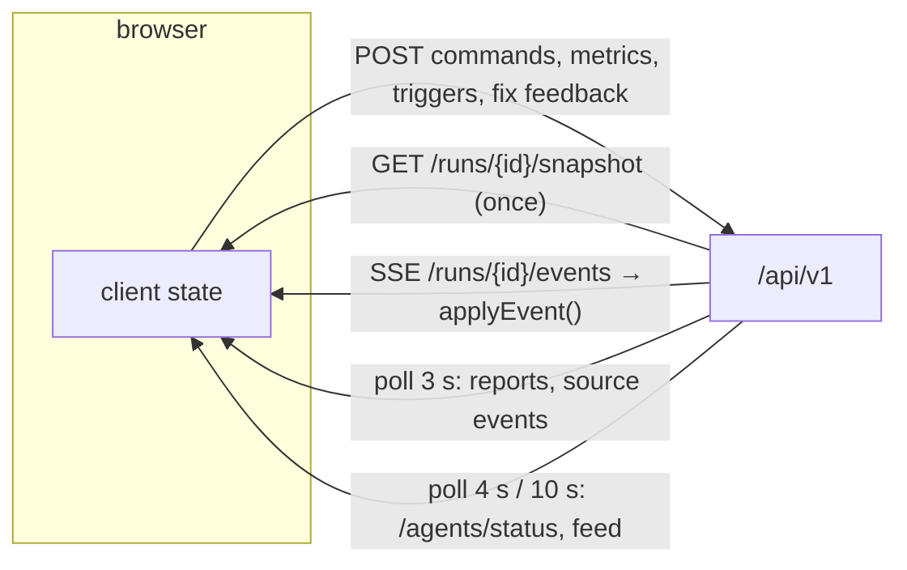

# 60 · Frontend: screens, state, live vs. illustrative

## Purpose and judging relevance

The demo is judged on whether "its graph, decisions, evidence and final report are easy to
follow" (20%). The UI is where people watch the loop run: playback, incidents moving through their
lifecycle, the investigation trail, agent status, briefs and fix proposals.

## Where it lives

`frontend/CHEETAH_UI_Prototype_v1.5.html`: one standalone HTML/CSS/JS file, no build step, served
by the backend at `/`. `frontend/assets/` holds a logo (not referenced; the HTML inlines its own).

## How it works

- **Run state** comes only from snapshot + SSE (`connectStream`, `applyEvent`), resumable with
  `Last-Event-ID`. The UI never polls domain tables for run state.
- **Reports and source events** are polled every 3 s (keyset pagination, CSV export streams the
  full filtered set).
- **Agent panels** poll the bus-backed `/agents/*` endpoints (status every 4 s, message/event feed
  every 10 s, per-agent runs when expanded).
- **Writes** are requests, never direct effects: simulation commands are queued; metric
  submissions, agent triggers and fix accept/reject become bus files
  ([principles](principles.md#11-async-control-plane)).

## Screens

| Screen | Shows | Source | Live? |
|---|---|---|---|
| Performance overview | six KPI tiles (Amount, Commission, Payout, Margin, Transactions, Campaigns), revenue vs locked band | `run_metrics`, outbox | live, including the in-progress day |
| Revenue forecast | daily actual vs band, 7-day outlook, TabPFN connection pill | `forecast.*` events, `/health` | live |
| Agentic Monitoring | incident kanban (Identified / In Progress / Resolved / Paused-Stopped), case panel with the investigation trail graph, agent roster and status, messages, briefs, discussions, fixes (accept / reject), metric submission form, manual triggers | outbox (`incident.updated`, `investigation.step`), `/agents/*` | live |
| Marketplace | campaign tiles, per-campaign commission / EPC / country revenue | `/source_events`, `/performance_report` | live, except the forecast-status pill and the baseline & investigation panel (hardcoded by design, MVP 2 scope) |
| Data & reports | five tabs over clicks, installs, live feed, summary, performance report | `/source_events`, `/performance_report` | live |
| Context Explorer | browsable context graph | built-in example model ("Example model · v0.2") | **illustrative**: does not read Neo4j (`/context/graph` is `unavailable`) |

A simulation toolbar (create / start / pause / resume / step / speed / replays) and a pause banner
sit across all screens.

**Investigation trail.** The two incident graphs on Agentic Monitoring are drawn only from
`investigation.step` events: Deviation → routed driver → investigator state → hypotheses or
dropped evidence → `Proposed` / `Inconclusive` (always labelled "not verified"). Pending stages are
greyed, never filled in.

## Interfaces

Endpoints consumed: everything under `/runs`, `/health`, and `/agents/*` listed in
[20-backend](20-backend.md#interfaces). Event types handled: see
[`ARCHITECTURE.md` §6](../ARCHITECTURE.md#6-outbox-event-types) plus `incident.updated` and
`investigation.step`.

## Status

| Built | Stubbed / deferred |
|---|---|
| All six screens, toolbar, SSE state, live KPIs, reports, incident board with real trail, agent panels, metric submission, fix feedback | Context Explorer is an example model, not the Neo4j graph |
| | Marketplace forecast pill and baseline panel hardcoded |
| | Replay buttons hit `409` endpoints |
| | Some header pills still read "Illustrative sample values" / "UI preview only" |

## Deep dives

- [`ARCHITECTURE.md` §3 Frontend, §4F–G](../ARCHITECTURE.md)
- `PRD/architecture_diagrams/07_frontend_screens.svg` (target)
- `PRD/PRD_findings_extension.md`: Reports screen scope cuts
